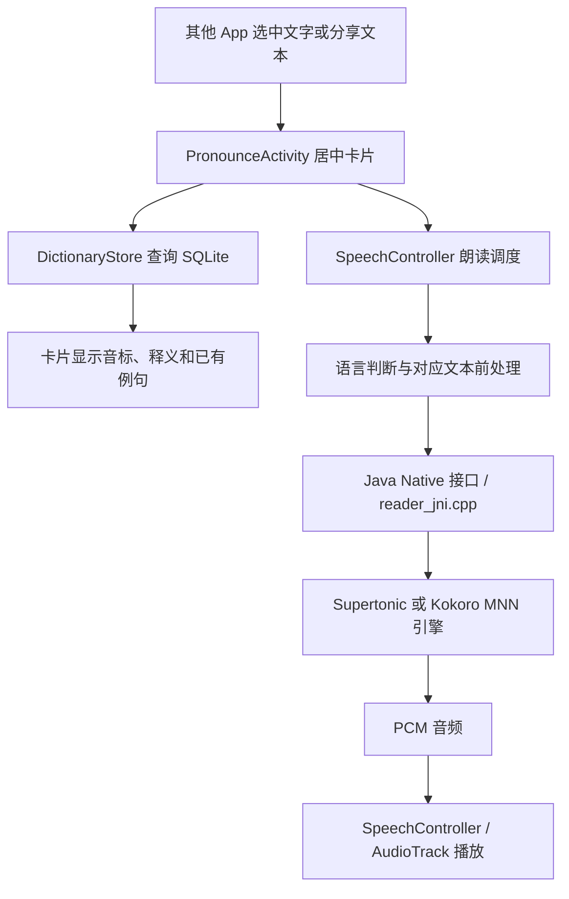

# MNN Offline Reader · 离线发音

[](https://github.com/bestkojima/mnn-offline-reader/actions/workflows/android.yml)

长按选中文字，点击系统菜单中的“发音”，打开居中卡片查词、看音标和例句，并在手机上合成语音。

An Android app for selected-text pronunciation, offline English dictionary lookup, and on-device TTS powered by MNN. Speech resources are downloaded from ModelScope rather than bundled in the APK.

## 安装与使用

在 [Releases](https://github.com/bestkojima/mnn-offline-reader/releases) 下载测试版 APK。要求 **Android 6.0 / API 23 或更高，arm64-v8a**；当前没有 32 位或 x86 APK。

1. 安装后打开 App，进入“下载语音”，按需下载中文或英语及其他语言资源，建议使用 Wi-Fi。
2. 在浏览器、阅读器等应用中长按并选中文字，点击“发音”。该入口可能藏在“更多”里，也可分享文字到本 App。
3. 在卡片中查看释义、音标和精选例句，点击“发音”或例句旁的“读”。可切换语言、音色及语速，收藏到生词本。

来源应用决定是否支持 Android `PROCESS_TEXT` 菜单。**本版处理可选中文字和分享文字，无法保证所有界面都能取字**；图片文字、不可选文字和禁止分享的页面需要后续 OCR/取字方案。

## 当前功能

| 功能 | 实现 |
| --- | --- |
| 跨应用入口 | Android `PROCESS_TEXT` 和 `SEND text/plain`，居中卡片 |
| 中文发音 | Kokoro-82M v1.0 MNN，女声 `zf_xiaoxiao`、男声 `zm_yunxi` |
| 英语及其他语言 | Supertonic 3 MNN int8，31 种语言、F1–F5 / M1–M5 十个音色 |
| 语言识别 | 本地 ML Kit 检测，可手动覆盖短词、专名和混合文字的判断 |
| 英语词库 | SQLite，49,664 词条、52,040 词形关联，释义与音标离线查询 |
| 精选例句 | 12 个词的 24 条自编中英例句；尚未覆盖整个词库 |
| 朗读控制 | 0.75× / 1.0× / 1.25× 语速，停止、新请求替换、音频焦点管理 |
| 生词本 | 与只读词库分开存储，历史最多保留 200 次查询 |

Supertonic 的 31 种语言：`en ko ja ar bg cs da de el es et fi fr hi hr hu id it lt lv nl pl pt ro ru sk sl sv tr uk vi`。中文由 Kokoro 处理；释义、音标和例句目前仅提供英语词库。

中文前处理使用词典最长匹配、多音词、词内三声变调及常用数字/日期规范化，可处理词典收录的中英混排。不能保证所有多音字语境、稀有字、数学表达式或英文专名；未收录内容会提示，避免静默漏读。当前采用 **v1.0**，并未切换到 v1.1-zh。

## 下一阶段：英语长文连续朗读

目标已确定，**尚未实现**：按自然语句切分文章，首句合成后尽快播放；播放当前句时提前合成后续句子，通过受限缓冲与持续音频流减少句间等待，增加暂停/继续、当前句高亮与阅读进度。英语阅读理解材料会先识别正文、题干和 ABCD 选项，在各部分之间保留明确停顿，避免全选后连读。连续性取决于手机的实际合成速度，不能仅靠分句保证所有设备零卡顿。

实现顺序、内存预算和验收要求见 [长文朗读计划](docs/LONG_TEXT_READING_PLAN.md)。本阶段优先英语及卡片前台阅读，后台/锁屏阅读另行规划；现有 v0.2.0 Release 不包含这些新功能。

## 模型下载与离线使用

APK **不内置 TTS 权重、音色和中文音素词典**。英语数据库、许可证与轻量离线语言识别仍随包提供。安装包目前约 18 MB，精确大小以 Release 附件为准。

| 下载包 | 资源大小 | ModelScope 仓库 | 固定 revision |
| --- | ---: | --- | --- |
| 中文语音 | 109,906,786 字节，约 110 MB | [Kokoro-82M-v1.0-MNN](https://modelscope.cn/models/dr3334/Kokoro-82M-v1.0-MNN) | `e7f9c985f3118427cb6646b9962ee4b91c536b0f` |
| 英语及其他语言 | 113,383,402 字节，约 113 MB | [Supertonic-3-INT8-MNN](https://modelscope.cn/models/dr3334/Supertonic-3-INT8-MNN) | `1dfd5693db1b62b2c49331b7674f9dee5c69385a` |

- 下载只在用户点击下载页按钮后启动，一次下载一组，支持移动网络；离开下载页会暂停。
- 断网、暂停和重启 App 后保留内部 `.part` 文件；再次点击“下载 / 继续”，通过 HTTPS `Range` 请求恢复。
- 206 响应必须匹配断点和总长；服务器忽略断点返回 200 时重新下载，避免错误拼接。
- 按固定清单校验大小和 SHA-256，成功后原子重命名；校验失败的模型不会载入，可重新下载。
- 完成下载后，检测、查词和语音合成都在本地运行。模型请求只包含文件路径和 revision，不上传选中文字。

两套下载资源合计约 **223.3 MB**，不保留第二份完整语音模型。安装总空间还包括 App、约 9 MB 的英语词库副本、原生库及运行缓存，不能只按 APK 大小估算。

无录音、悬浮窗或无障碍权限；网络权限用于模型下载。本版没有后台下载前台服务、OCR、云端查词或整句翻译。

## 从源码构建

需要 Git、JDK 17、Python 3、curl，以及 Android SDK 35、NDK `28.1.13356709`、CMake `3.31.6`。Gradle Wrapper 为 `8.11.1`，Android Gradle Plugin 为 `8.9.3`。

```bash
git clone --recurse-submodules https://github.com/bestkojima/mnn-offline-reader.git
cd mnn-offline-reader

# 如果克隆时没有初始化子模块：
git submodule update --init --depth 1

# 设置 ANDROID_HOME，或在 Android Studio 中选择 SDK。
sdkmanager 'platforms;android-35' 'build-tools;35.0.0' \
  'ndk;28.1.13356709' 'cmake;3.31.6'

# 只准备英语词库，构建时不下载 TTS 模型。
bash scripts/prepare_assets.sh
./gradlew :app:assembleDebug :app:testDebugUnitTest :app:lintDebug :app:assembleDebugAndroidTest
```

APK 输出：`app/build/outputs/apk/debug/app-debug.apk`。调试版仅供测试，正式发布需要配置自己的稳定签名；来自不同构建环境的 debug APK 可能无法直接覆盖安装。

MNN 通过 Git 子模块固定在公开上游 commit `cda4a6f441b8ed58cc5c6f389359e5851e9d6322`。CMake 默认使用 `vendor/MNN`，也可通过 `-PmnnRoot=/absolute/path/to/MNN` 指定已有源码目录。

**MNN 从源码编译，native 使用 `-O3 -DNDEBUG`，包括 debug APK。** 启用 `MNN_LOW_MEMORY` 与 `MNN_ARM82`，静态链接到 JNI 的 `libenglish_reader.so`；不是下载预编译 MNN `.so`。ML Kit 语言识别使用其供应商运行库。Java → JNI → MNN Module API；Supertonic 输出 44.1 kHz，Kokoro 输出 24 kHz 单声道 PCM16。两个引擎按语言切换，切换时释放旧引擎；内存 PCM 缓存上限 10 MiB。

依赖下载困难时，可选择 Google Maven 镜像：

```bash
MNN_MAVEN_MIRROR=https://maven.aliyun.com/repository/google ./gradlew :app:assembleDebug
```

词库脚本固定 ECDICT commit 和 SHA-256，源 CSV 缓存在 `models/english-reader-dictionary/`。模型、缓存、生成的数据库、构建输出和本机配置均不进入 Git。构建会拒绝 assets 中的 TTS 模型二进制与未完成文件。

## 测试与验证边界

```bash
python3 scripts/test_dictionary.py
python3 scripts/test_kokoro_assets.py
./gradlew :app:testDebugUnitTest :app:lintDebug

# 连接 arm64 手机，先在下载页下载两套资源，再执行设备测试：
./gradlew :app:connectedDebugAndroidTest
```

已通过 **29 项 Java 单元测试、4 项 Python 测试、构建及 lint**。其中 10 项下载测试使用真实本地 HTTP 响应，覆盖暂停恢复、200/206 行为、校验失败、损坏修复与离线复用。实际生产 Java 下载器已从 ModelScope 下载全部 26 个资源文件，完成真实中断后换新下载器恢复与逐文件校验。

此前开发机已完成 Supertonic 多语言和 Kokoro 中文的真实 MNN 合成、取消与恢复。APK 签名、ZIP 16 KB 对齐及三个 native ELF 的 16 KB LOAD 对齐已检查。

**尚未进行安卓真机验收。** 设备端下载、来源应用菜单、卡片交互、语言检测、JNI 播放、主观音质、出声延迟与峰值内存仍需验证；开发机通过不能视为手机性能结论。已有验证记录见 [docs/verification-download.json](docs/verification-download.json)。首次 Release 复用仓库拆分前已构建的下载版 APK；按用户要求，发布独立仓库时不再完成新一轮构建和测试。

GitHub Actions 提供手动构建工作流：初始化 MNN、生成词库并运行构建/单元测试/lint，保留 APK 与报告。上传代码不会自动触发该工作流；它不执行真机测试，也不发布 TTS 权重。

## 项目结构

这是一个独立的 Android App 仓库。Java 负责界面、查词、下载与播放调度，C++ 负责调用 MNN 合成语音，Python 脚本负责构建词库和准备发布资源。MNN 推理引擎通过固定版本的 Git 子模块引入。

```text
app/
├── build.gradle                         Android 依赖、构建设置与资源检查
└── src/
    ├── main/
    │   ├── AndroidManifest.xml           权限、应用入口和跨应用选字/分享入口
    │   ├── java/com/alibaba/mnn/english/  界面、SQLite、下载、语言识别和语音调度
    │   ├── cpp/                          JNI 桥接与两套 MNN TTS 引擎
    │   ├── assets/                       模型下载清单、许可及生成的英语数据库
    │   └── res/                          界面文字、主题和备份规则
    ├── test/                             Java 单元测试与开发机验证工具
    └── androidTest/                      需要 Android 设备的集成测试
data/                                    原始精选例句、资源版本锁与上传记录
scripts/                                 词库生成、模型资源准备及 ModelScope 发布工具
vendor/MNN/                              固定版本 MNN 源码子模块
docs/                                    设计、调研、验证记录与下一阶段计划
gradle/wrapper/                          固定 Gradle 版本的 Wrapper
.github/workflows/android.yml            手动触发的构建工作流
models/                                  本机下载/整理的资源，生成后存在，不提交 Git
```

### 主要代码各自负责什么

以下 Java 文件都位于 `app/src/main/java/com/alibaba/mnn/english/`。界面通过 Java 代码创建，因此卡片布局主要看 Activity 与 `Ui.java`，不是查找布局 XML。

| 文件 | 职责 |
| --- | --- |
| [MainActivity.java](app/src/main/java/com/alibaba/mnn/english/MainActivity.java) | 安装后打开的首页，提供下载入口、生词本及使用说明 |
| [PronounceActivity.java](app/src/main/java/com/alibaba/mnn/english/PronounceActivity.java) | 接收其他 App 选中/分享的文字，显示居中卡片，连接查词、语言选择与朗读操作 |
| [Ui.java](app/src/main/java/com/alibaba/mnn/english/Ui.java) | 创建文字、按钮、卡片、滚动区域及共用样式 |
| [ReaderApplication.java](app/src/main/java/com/alibaba/mnn/english/ReaderApplication.java) | 创建共享的查词、下载、语言识别和语音对象，管理数据库工作线程及后台内存释放 |
| [DictionaryStore.java](app/src/main/java/com/alibaba/mnn/english/DictionaryStore.java) | 只读 SQLite 查询：单词/词形 → 音标、释义、关联例句 |
| [LearningStore.java](app/src/main/java/com/alibaba/mnn/english/LearningStore.java) | 独立 `user.db`，保存生词本与最近查询，避免修改发布词库 |
| [LanguageDetector.java](app/src/main/java/com/alibaba/mnn/english/LanguageDetector.java) / [TtsLanguages.java](app/src/main/java/com/alibaba/mnn/english/TtsLanguages.java) | 本地识别语言、处理手动选择，并定义支持的语言与显示名称 |
| [SpeechController.java](app/src/main/java/com/alibaba/mnn/english/SpeechController.java) | 调度合成与 AudioTrack 播放，处理停止、新请求替换、PCM 缓存和音频焦点 |
| [TextNormalizer.java](app/src/main/java/com/alibaba/mnn/english/TextNormalizer.java) | Supertonic 文本规范化、当前分块规则及 `<en>…</en>` 等语言标记 |
| [KokoroFrontend.java](app/src/main/java/com/alibaba/mnn/english/KokoroFrontend.java) | 中文和词典支持的中英混排前处理，将文本转成 Kokoro 所需音素 ID |
| [ModelAssets.java](app/src/main/java/com/alibaba/mnn/english/ModelAssets.java) | 安装内置词库副本，读取已下载模型的配置、音色与前处理资源，提供引擎创建参数 |
| [ModelDownloadActivity.java](app/src/main/java/com/alibaba/mnn/english/ModelDownloadActivity.java) | 模型下载页面，展示状态、进度及暂停/继续按钮 |
| [ModelDownloads.java](app/src/main/java/com/alibaba/mnn/english/ModelDownloads.java) / [ResumableDownloader.java](app/src/main/java/com/alibaba/mnn/english/ResumableDownloader.java) | 前者协调模型包和下载状态；后者执行断点下载、响应检查、大小/SHA-256 校验及完成文件替换 |
| [SupertonicNative.java](app/src/main/java/com/alibaba/mnn/english/SupertonicNative.java) / [KokoroNative.java](app/src/main/java/com/alibaba/mnn/english/KokoroNative.java) | Java 到 C++ 的 JNI 接口，提供引擎创建、合成、取消和销毁 |

C++ 的 [reader_jni.cpp](app/src/main/cpp/reader_jni.cpp) 接收 Java 请求；[supertonic_engine.cpp](app/src/main/cpp/supertonic_engine.cpp) 与 [kokoro_engine.cpp](app/src/main/cpp/kokoro_engine.cpp) 分别加载和运行对应的 MNN 模型，返回 PCM 音频。[CMakeLists.txt](app/src/main/cpp/CMakeLists.txt) 管理原生编译和 MNN 链接；`smoke_main.cpp` 与 `kokoro_smoke.cpp` 是开发机合成验证入口。

### 一次选字朗读如何经过这些模块



查词与语音是两个流程：查词直接读本地 SQLite；朗读先通过 `ModelAssets` / `ModelDownloads` 确认对应语音资源可用，再进行前处理和 JNI 合成。缺少模型时提示下载，已有词库仍可查询。查询与磁盘操作放在工作线程，界面更新回到主线程。

模型下载另走 `ModelDownloadActivity → ModelDownloads → ResumableDownloader → ModelScope`。下载按 `assets/model-catalog.json` 中固定的 revision、文件路径、大小和 SHA-256 执行，未完成文件保留为 `.part`；完整校验成功后才供 `ModelAssets` 加载。

**上述是当前版本的关系。** 现在 `SpeechController` 仍然按块依次“合成 → 播放完 → 合成下一块”。下一阶段的并行预合成、连续播放器，以及题干/ABCD 结构识别见 [长文朗读计划](docs/LONG_TEXT_READING_PLAN.md)，尚未接入当前 Release。

### 词库、模型和个人数据放在哪里

| 数据 | 构建/运行方式 |
| --- | --- |
| 英语词库 | `scripts/prepare_assets.sh` 获取固定 ECDICT CSV，再由 `build_dictionary.py` 生成 `assets/dictionary.db` 与校验清单；数据库随 APK 提供，运行时复制到应用内部目录并只读查询 |
| 双语例句 | 当前来源为 `data/examples.json`，构建时导入同一个 SQLite 的 `examples` 表，按词条关联；目前仍只有 12 个词的 24 条例句 |
| TTS 模型、音色和中文前处理词典 | 按下载清单从 ModelScope 获取，存到应用内部目录；权重不进入 APK，也不进入 Git |
| 生词本与历史 | 运行时写入应用内部的 `user.db`，与只读英语词库分开 |
| 语言识别资源 | 由 ML Kit 随安装包提供，在本地运行 |

`data/model-lock.json` 与 `data/kokoro-lock.json` 记录上游资源版本；`data/modelscope-release.json` 记录上传结果；`assets/model-catalog.json` 是 App 实际使用的下载清单。它们是元数据，不是模型权重。

普通构建只需要准备词库。`prepare_models.py`、`prepare_kokoro.sh` / `prepare_kokoro.py` 用于维护者整理固定语音资源，`stage_modelscope_release.py` 生成发布目录，`upload_modelscope.py` 上传并生成固定下载清单；这组维护脚本不在手机中运行。

### 建议的阅读顺序

1. 看 [AndroidManifest.xml](app/src/main/AndroidManifest.xml) 和 `PronounceActivity.java`，理解跨应用入口与卡片操作。
2. 看 `DictionaryStore.java`、`LearningStore.java`，理解词库查询和个人数据保存。
3. 看 `SpeechController.java`，再沿 `ModelAssets.java → 文本前处理 → Native 接口 → reader_jni.cpp → 对应引擎` 理解离线合成与播放。
4. 看 `ModelDownloads.java`、`ResumableDownloader.java` 和 `model-catalog.json`，理解模型如何下载、校验和载入。
5. 需要修改资源或理解后续方向时，再看 `scripts/`、版本锁文件和 `docs/`。

## 来源与许可

App 源码采用 [Apache-2.0](LICENSE)，MNN 原始声明保留在 [NOTICE](NOTICE) 与 App 内许可页。模型、词库和 SDK 各自的许可独立适用：

| 组件 | 来源与许可 |
| --- | --- |
| MNN | [alibaba/MNN](https://github.com/alibaba/MNN)，Apache-2.0 |
| Supertonic 3 | [Supertone 原模型](https://huggingface.co/Supertone/supertonic-3)，BigScience Open RAIL-M；[MNN int8 转换](https://huggingface.co/yunfengwang/supertonic-tts-mnn) |
| Kokoro v1.0 | [hexgrad/Kokoro-82M](https://huggingface.co/hexgrad/Kokoro-82M)，Apache-2.0；[MNN 转换](https://huggingface.co/wangjazz/kokoro-82m-mnn) |
| Kokoro 前处理与音色 | [固定词典](https://huggingface.co/csukuangfj/kokoro-multi-lang-v1_0)、[音色来源](https://huggingface.co/onnx-community/Kokoro-82M-v1.0-ONNX)，完整声明随下载资源和 App 提供 |
| 英语词库 | [ECDICT](https://github.com/skywind3000/ECDICT)，MIT；精选例句由本项目编写 |
| 语言识别 | [ML Kit](https://developers.google.com/ml-kit/language/identification/android)，使用供应商 SDK 及其条款 |

上游来源 commit、文件大小及 SHA-256 保存在 `data/model-lock.json`、`data/kokoro-lock.json` 和 `data/modelscope-release.json`；下载所用 ModelScope commit 保存在 `app/src/main/assets/model-catalog.json`。

进一步阅读：[设计记录](docs/ANDROID_ENGLISH_READER_DESIGN.md) · [中文 TTS 候选](docs/CHINESE_TTS_MODEL_CANDIDATES.md) · [跨应用交互研究](docs/ANDROID_TRANSLATION_APP_UX_RESEARCH.md)。
